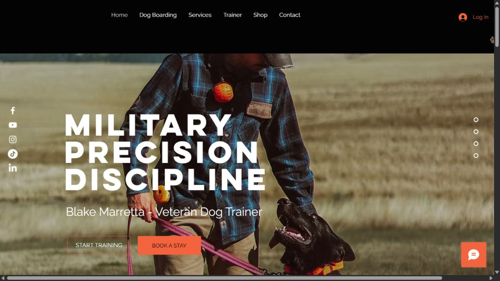
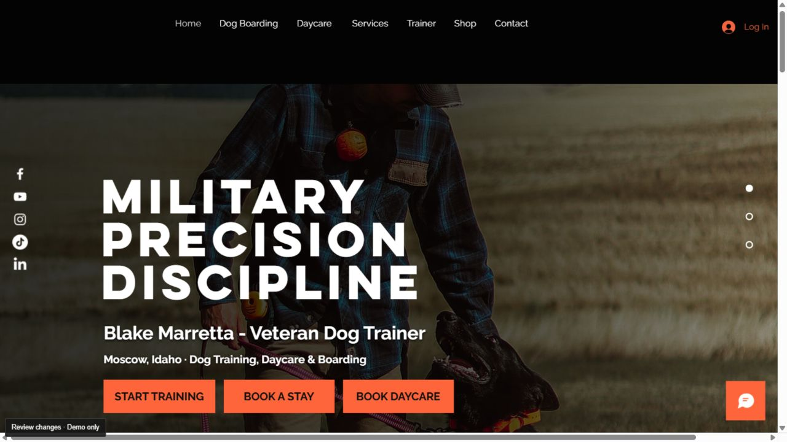
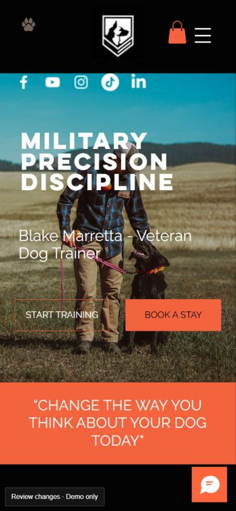
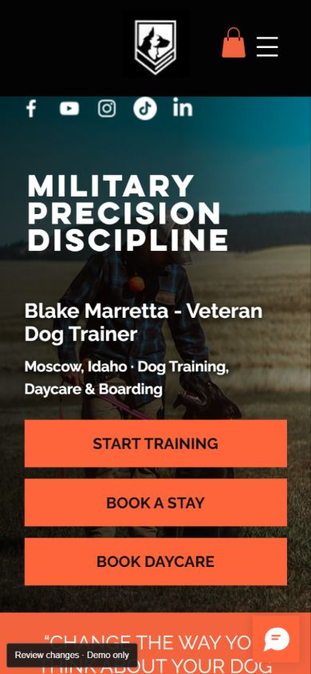
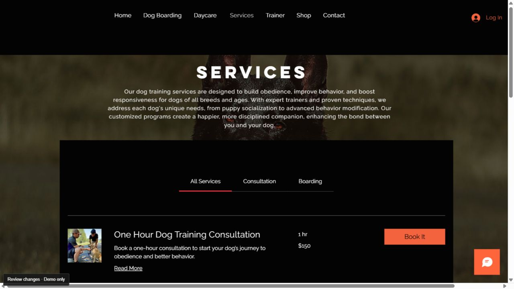

# O4K9 review feedback — November 19, 2026

The revised homepage keeps the original photograph and headline. Its three actions now use solid orange backgrounds, bold dark labels, larger targets and a visible keyboard focus outline. The service/location line is larger, with dark shading behind the hero text. On mobile the actions stack inside the hero without horizontal overflow.

The rejected training-package popup and its enquiry/consultation shortcuts have been removed. Package links retain the original Services-page behavior. The separate boarding-card destination fix remains.

The comparison presentation now has 16 slides: original slides 3 and 4 (duplicate mobile navigation discussion) and 6 (package-popup proposal) were removed. Slide 2 contains the new desktop comparison and enlarged action details. The other hero screenshot, decisions and capture-source information were refreshed as well.

These captures show the working branch served at `http://127.0.0.1:3050/o4k9#/`, pending deployment. The desktop before image is a fresh capture of the live original site. The mobile before image uses the preserved original Wix mobile snapshot in baseline mode. Screenshots are actual browser captures; the presentation crops the action area for readability.

## Desktop

Before:

After:

## Mobile

Before:

After:

## Restored package navigation

Clicking Bronze opens Services on desktop and mobile, with no dialog:

## Verification

- Desktop labels: bold 18px; actions at least 54px tall.
- Mobile labels: bold 16px; actions at least 48px tall on the original 320px canvas. Canvas scroll width equals client width (320px).
- `#111111` text on `#FF653B` buttons: calculated contrast 6.45:1. [W3C text-contrast reference](https://www.w3.org/WAI/WCAG22/Understanding/contrast-minimum.html).
- Keyboard navigation shows a white focus outline; all three actions remain links.
- Baseline mode adds neither the revised hero actions nor the shading.
- Package links navigate to Services with zero dialogs on desktop and mobile.
- JS syntax and static isolation/resource checks pass. All 533 HTTP checks pass across 98 snapshots and 530 resources; see [route checks](../o4k9-route-checks.json).

Measured browser evidence is in [browser-checks.json](browser-checks.json). No real bookings, logins, payments or messages were submitted. Existing Firebase configuration requirements for the full recipe-app production build are described in [preview documentation](../o4k9-preview.md).
