# O4K9 Website Proposal — current review evidence

The 16-slide presentation compares the current O4K9 site with **Proposed**. Fresh November 19 browser captures show the existing consultation page, transparent program pricing, revised homepage program information and separate care services. All proposed screens come from the local disconnected mockup at `http://127.0.0.1:3050/o4k9`.

## Training uses the existing consultation page

Training and Start Training open `/service-page/one-hour-dog-training-consultation`. Proposed normalizes legacy `/services` and `/training` links to this existing URL. The native consultation details and Book Now path remain. Blake confirmed that its required **$150 consultation fee is additional to the program price and is not credited**.

Current live page:

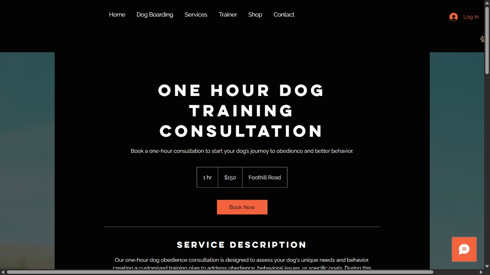

Proposed:

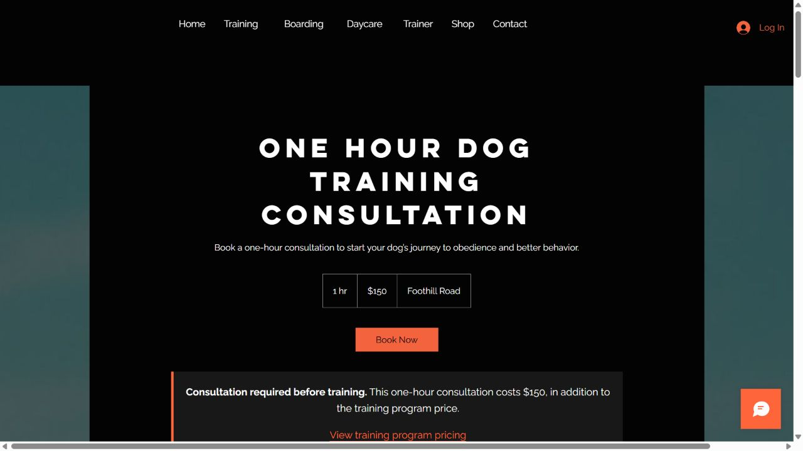

## Program prices before the cancellation policy

Pricing and published inclusions appear before the gallery and cancellation policy. Both the program fee and the combined program-plus-consultation cost are visible. These are informational figures; the consultation booking itself remains $150.

| Program | Program price | Program + consultation |
| --- | ---: | ---: |
| Bronze | $1,050 | $1,200 |
| Bronze Plus | $1,100 | $1,250 |
| Silver | $1,250 | $1,400 |
| Silver Plus | $1,400 | $1,550 |
| Platinum | $2,300 | $2,450 |

Current policy area:

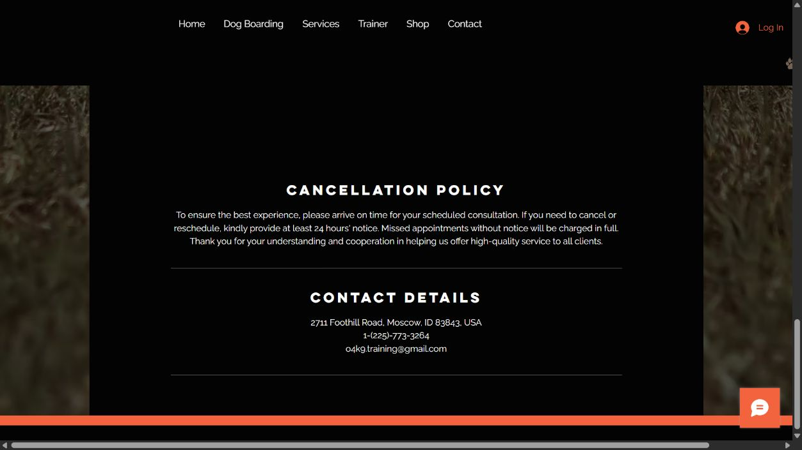

Proposed desktop and mobile:

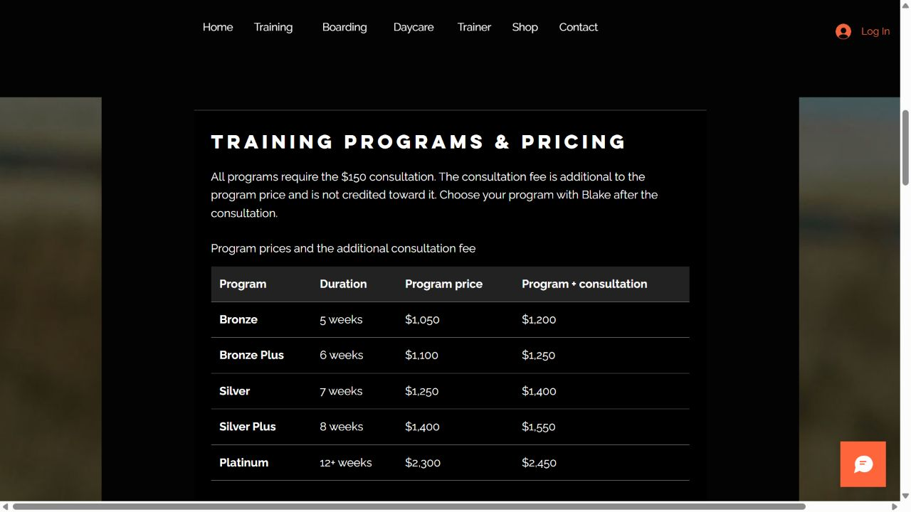

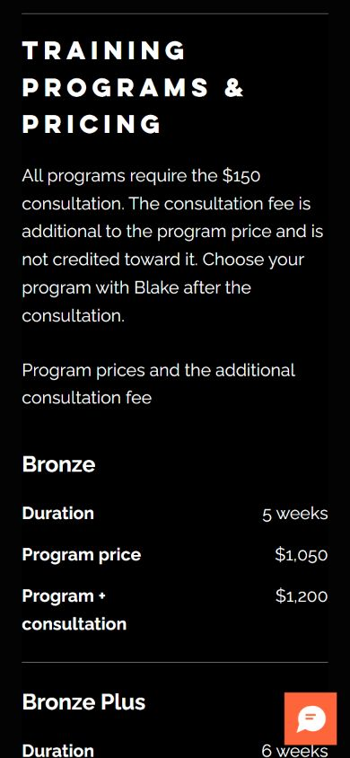

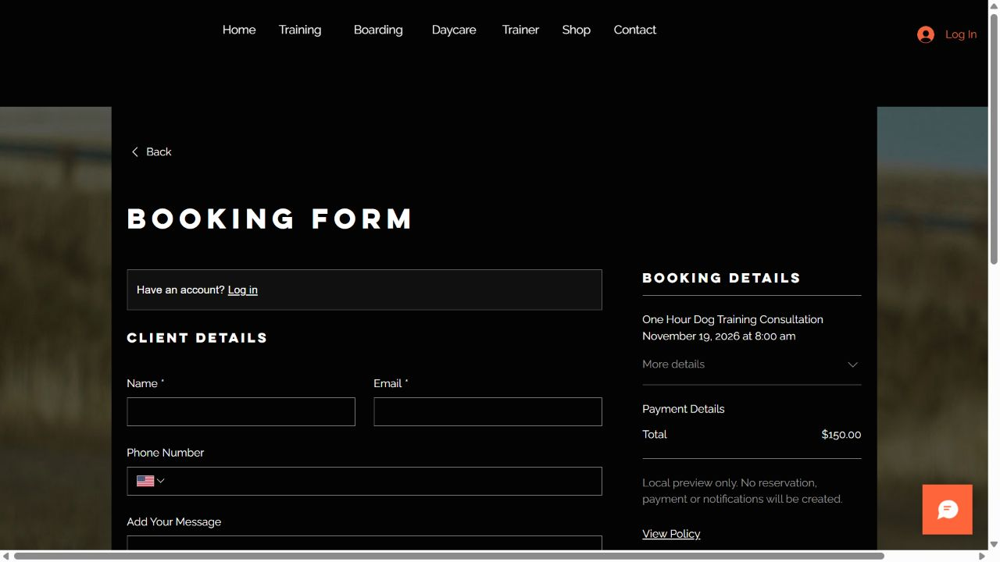

## Homepage explains programs before booking

Replace “Choose your Plan” with “Training Programs & Pricing.” Five informational cards retain the published prices, durations and inclusions. They disclose the extra consultation fee and combined cost; links jump to the existing consultation page's pricing. One Book a Consultation action follows the cards. Reactive Rehab remains a separate variable-price entry with the additional consultation explained.

Current live section:

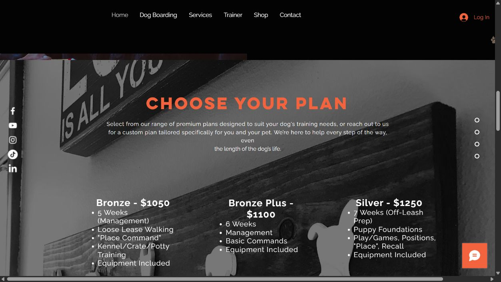

Proposed:

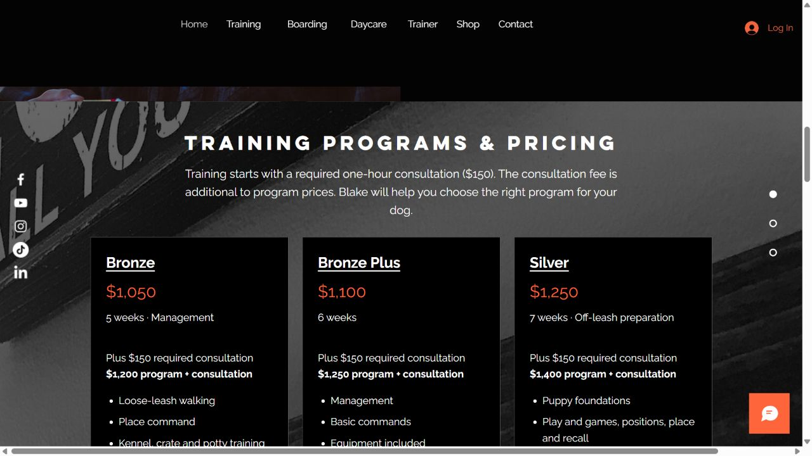

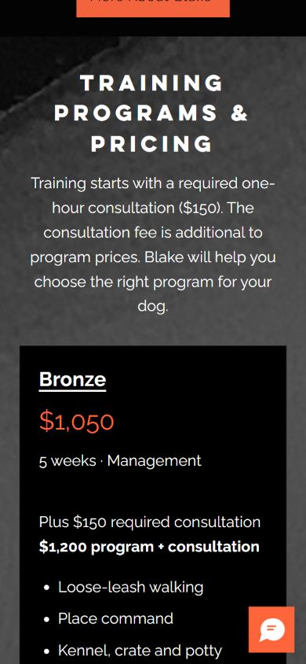

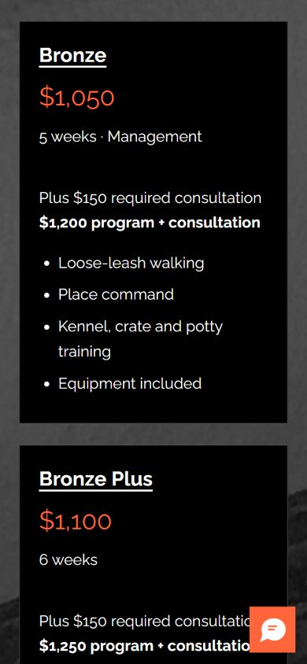

## Boarding and Daycare have their own care group

Published rates and direct booking links sit outside the training programs. Boarding starts at $50/night for the first dog, plus $40 for a second and $20 for a third. Daycare is $25/day. Reactive Rehab has its own entry rather than sharing a numbered plan list.

Current live section:

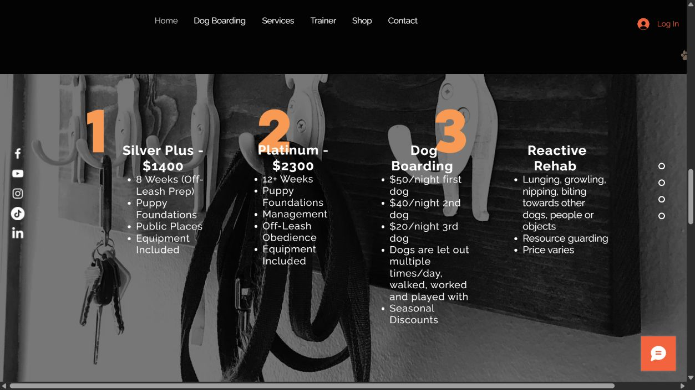

Proposed:

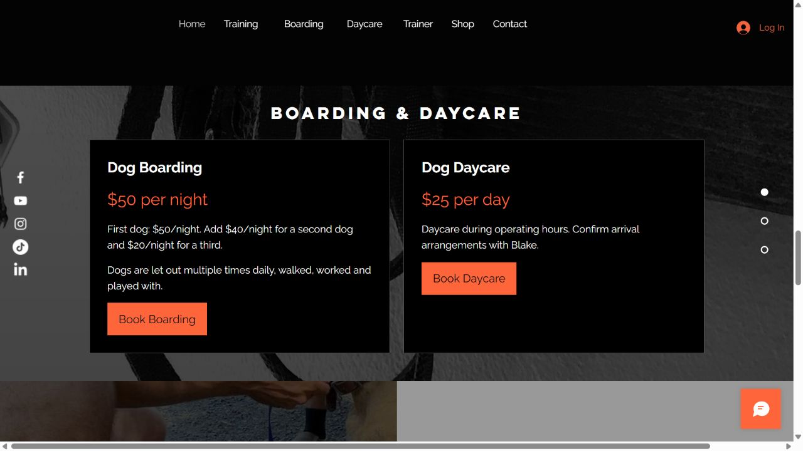

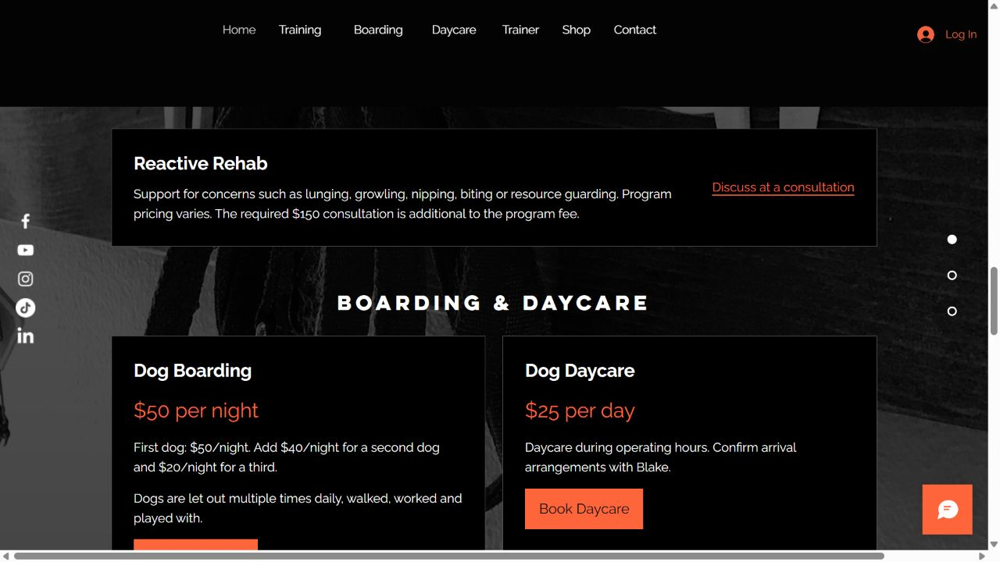

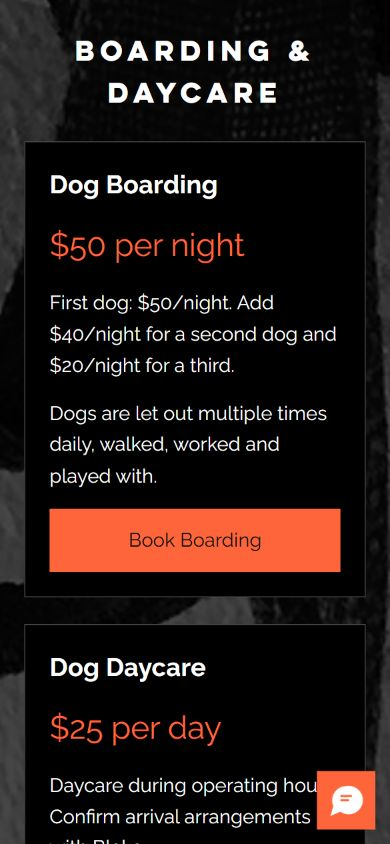

## Other accepted recommendations

The hero retains the original photograph and headline. Its solid orange actions use normal 400-weight labels and larger targets. Navigation and service text use Training, Boarding, Daycare consistently, with Book Boarding wording. The readable help panel, contact footer, Dogs/Kennels labels and amenities cleanup remain in the presentation.

- [Desktop hero](home-desktop-after.jpg) and [mobile hero](home-mobile-after.jpg)
- [Boarding wording](boarding-proposed.jpg)
- [Readable help](booking-help-proposed.jpg) and [footer](footer-proposed.jpg)
- [Mobile menu](menu-mobile-proposed.jpg) and [mobile help/footer](help-footer-mobile-proposed.jpg)

The user confirmed the installed language controls at **Hotels → Property Setup → Languages → Booking Engine**. See [Wix Hotels documentation](wix-hotels-feasibility.md).

## Verification and Wix implementation

[Current browser checks](consultation-pricing/browser-checks.json) record canonical routing, both aliases, all five combined costs, section order, the $150 consultation summary, separate care destinations and mobile layout. At 390×844, the original Wix canvas has matching client/scroll widths of 320px on home and consultation. Mobile pricing uses stacked labeled rows. Baseline has no added pricing or fee notice, and Daycare has no consultation pricing. No real booking, login, payment or message was submitted.

JS syntax and isolation/resource checks pass. [Route checks](../o4k9-route-checks.json) cover 98 snapshots and 530 resources with 533 successful HTTP checks. Earlier hero/focus evidence is in [browser-checks.json](browser-checks.json), and boarding/footer checks are in [blake-review-checks.json](blake-review-checks.json). Earlier bespoke Training-page captures are historical, not the current proposal.

In Wix, redirect `/services` to the existing consultation URL and point navigation there. Add pricing to the consultation's service-specific description or supported elements. Verify the editor's placement/table controls; do not add consultation content indiscriminately to the shared Daycare service-page template. This local hash redirect is a demonstration, not an HTTP 301. No production Wix content was changed. See [preview documentation](../o4k9-preview.md) for app isolation and the existing Firebase-dependent production-build limitation.
