# O4K9 review feedback — November 19, 2026

The revised homepage keeps the original photograph and headline. Its three actions use solid orange backgrounds, dark labels at the original normal 400 weight, larger targets and a visible keyboard focus outline. The service/location line is larger, with dark shading behind the hero text. On mobile the actions stack inside the hero without horizontal overflow.

The rejected training-package popup has been removed. Training/package links now open the dedicated Training page, with the required consultation first. The separate boarding-card destination fix remains.

The presentation is titled **O4K9 Website Proposal** and has 15 slides. It uses “Proposed” consistently and omits repetitive comparison subtitles. The standalone spelling slide was removed; two new comparisons explain the required consultation and program inclusions. The amenities slide says **Clean up Hotel Amenities listing**. The closing slide focuses on Blake’s decisions.

The homepage action now says **Book Boarding**. Menus, actions and service copy consistently use **Training, Boarding, Daycare**. The help panel uses readable dark text on white, and the contact footer is visible above the original Wix background. Mobile layouts were checked at 390×844 without horizontal overflow. The date-enquiry button opens Contact with the date filled in and does not submit anything.

The user confirmed the language controls in Blake’s installed app at **Hotels → Property Setup → Languages → Booking Engine**. Proposed uses Dogs/Kennels wording, including the details panels and accessible labels. See [Wix Hotels feasibility and documentation links](wix-hotels-feasibility.md).

These captures show the working branch served at `http://127.0.0.1:3050/o4k9#/`, pending deployment. The desktop before image is a fresh capture of the live original site. The mobile before image uses the preserved original Wix mobile snapshot in baseline mode. Screenshots are actual browser captures; the presentation crops the action area for readability.

## Desktop

Before:

After:

## Mobile

Before:

After:

## Training begins with the required consultation

Blake requires a consultation before every training program. Training leads with the existing one-hour, $150 consultation. Programs preserve existing prices/durations and show the inclusions published on the homepage. The booking action opens the disconnected consultation calendar and continues to a $150 summary. No booking is submitted.

Before:

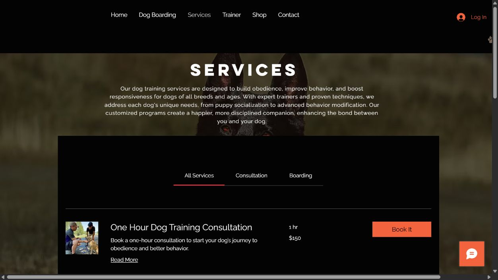

Proposed:

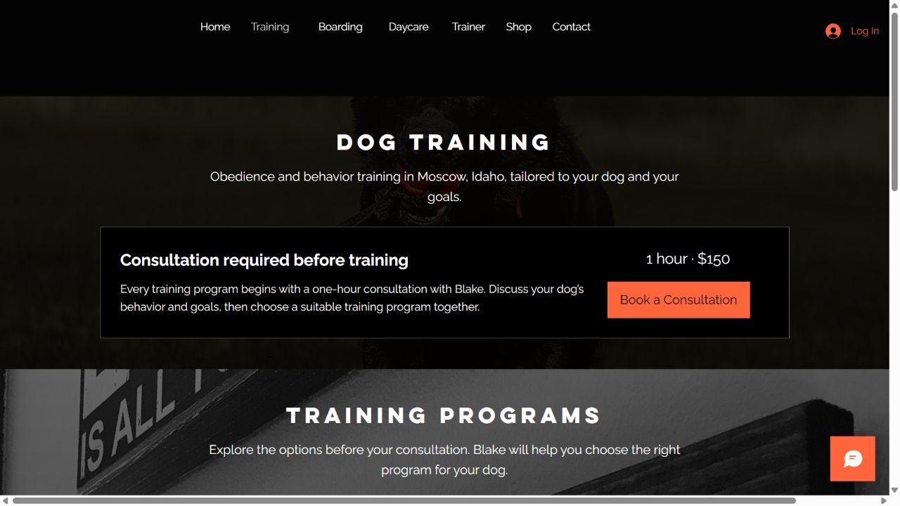

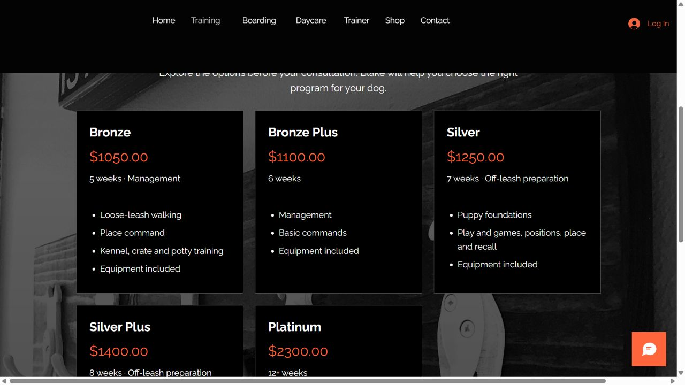

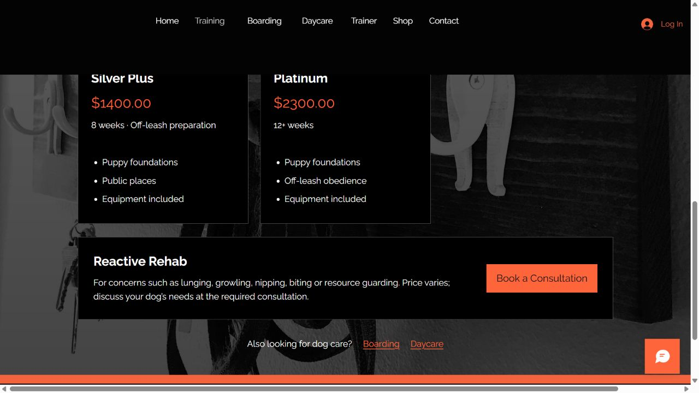

Mobile:

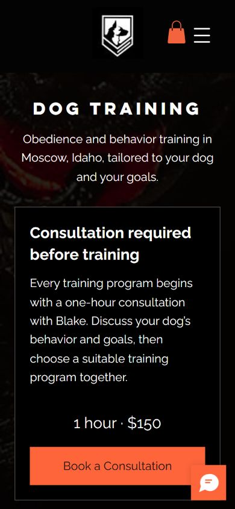

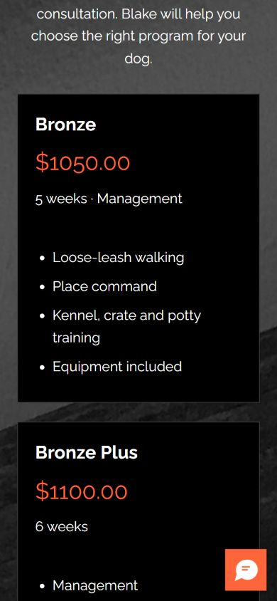

## Boarding wording

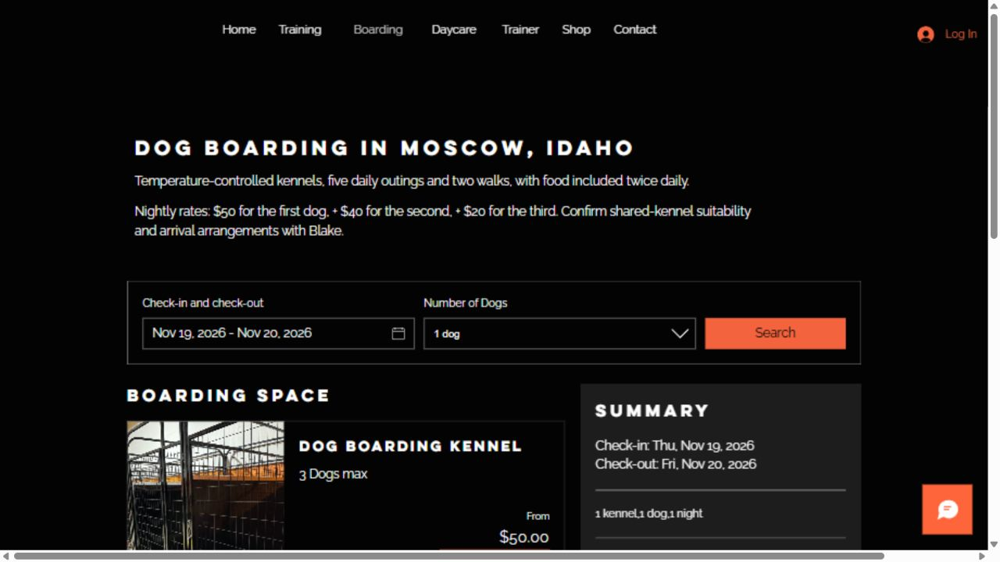

## Readable booking help

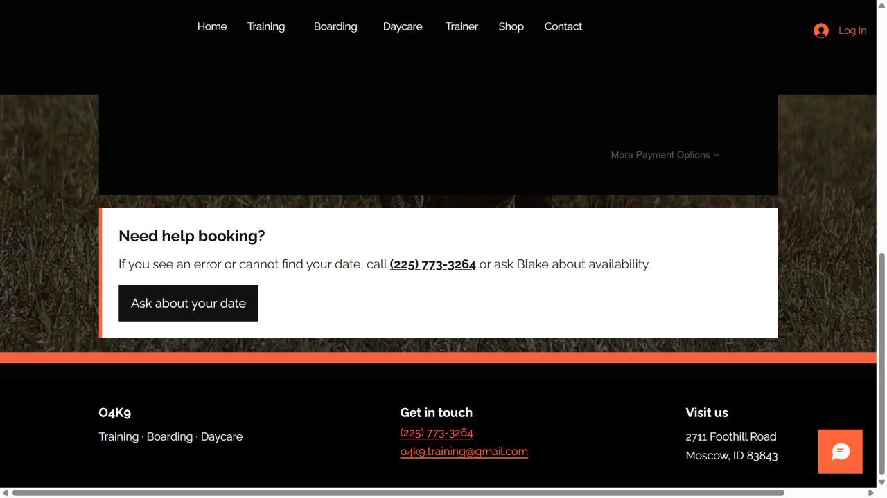

## Contact footer

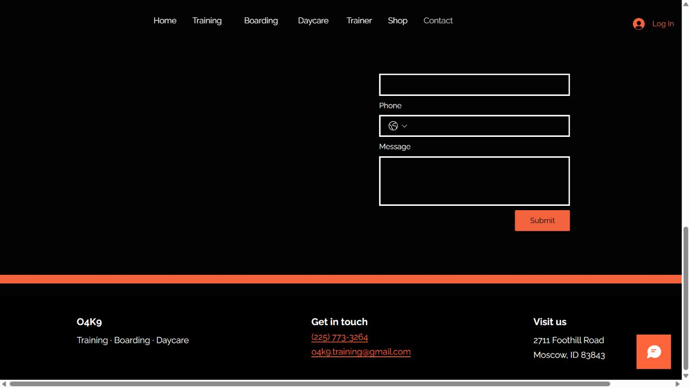

## Mobile menu, help and footer

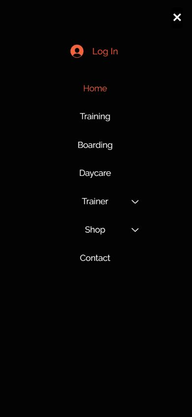

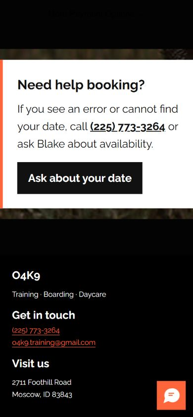

## Verification

- Desktop labels: normal 400 weight at 18px; actions at least 54px tall.
- Mobile labels: normal 400 weight at 16px; actions at least 48px tall on the original 320px canvas. Canvas scroll width equals client width (320px).
- `#111111` text on `#FF653B` buttons: calculated contrast 6.45:1. [W3C text-contrast reference](https://www.w3.org/WAI/WCAG22/Understanding/contrast-minimum.html).
- Keyboard navigation shows a white focus outline; all three actions remain links.
- Baseline mode adds neither the revised hero actions nor the shading.
- Training/package links navigate to Training without package popups. Legacy Proposed `#/services` links normalize to `#/training`; the original Services snapshot remains available in baseline mode.
- JS syntax and static isolation/resource checks pass. All 533 HTTP checks pass across 98 snapshots and 530 resources; see [route checks](../o4k9-route-checks.json).

Current Training/button evidence is in [training-review-checks.json](training-review-checks.json). Earlier boarding/footer checks are in [blake-review-checks.json](blake-review-checks.json), and initial button/focus geometry is in [browser-checks.json](browser-checks.json). The renamed Add kennel action was also verified: it updates only the demo stay and shows a $50 sample total. No real bookings, logins, payments or messages were submitted. Existing Firebase configuration requirements for the full recipe-app production build are described in [preview documentation](../o4k9-preview.md).
